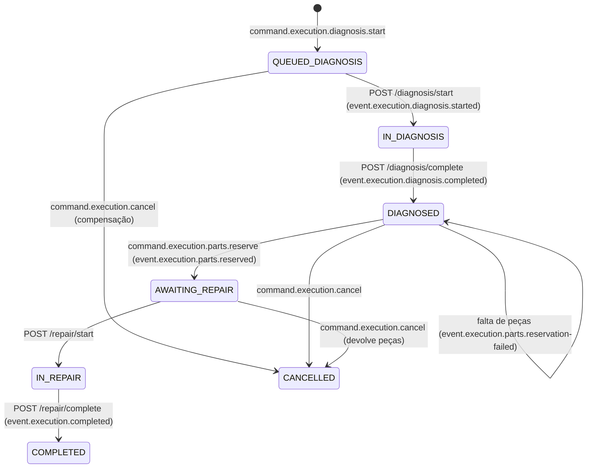

# Execution Service — Execução e Produção

[](https://github.com/pedrocmoreira/execution-service/actions/workflows/ci-cd.yml)
[](https://sonarcloud.io/project/overview?id=pedrocmoreira_execution-service)
[](https://sonarcloud.io/project/overview?id=pedrocmoreira_execution-service)

Microsserviço da **oficina/produção**: gerencia a **fila de execução** das OS, o **diagnóstico** e o **reparo**
feitos pelo mecânico, o **estoque de peças** (reserva/baixa) e **comunica a finalização** ao OS Service.

| Item | Valor |
|---|---|
| Porta | `8083` |
| Banco | **MongoDB** (`execution_db`) — NoSQL de documentos |
| Mensageria | consome `command.execution.#` (fila `execution-service.commands` + DLQ) e publica `event.execution.*` |
| Swagger | `http://localhost:8083/swagger-ui.html` |

## Por que MongoDB?
Cada item da fila é um **documento autocontido**: lista variável de serviços e peças e a **linha do tempo** de atualizações do
mecânico (`timeline`). Esses dados são lidos e gravados sempre juntos, por OS, sem joins, e o esquema evolui com frequência
(novas etapas e anotações de diagnóstico). O estoque (`parts_inventory`) usa **bloqueio otimista** (`@Version`) para reservas concorrentes.
Com isso cumprimos o requisito de usar ao menos um banco NoSQL (os outros dois serviços usam PostgreSQL).

## Fluxo



- **Reserva de peças "tudo ou nada"**: valida todas as peças; se alguma falhar no meio, desfaz as já reservadas (rollback local).
- **Compensação** (`command.execution.cancel`): devolve as peças reservadas ao estoque e retira a OS da fila.
- Comandos idempotentes (OS já na fila e peças já reservadas são reconhecidas).

## Endpoints
| Método | Rota | Descrição |
|---|---|---|
| GET | `/api/executions[?status=]` | Execuções |
| GET | `/api/executions/queue` | Fila ativa (prioridade desc, chegada asc) |
| GET | `/api/executions/{osId}` | Execução de uma OS (com timeline) |
| POST | `/api/executions/{osId}/diagnosis/start` · `/diagnosis/complete` | Diagnóstico |
| POST | `/api/executions/{osId}/repair/start` · `/repair/complete` | Reparo |
| PATCH | `/api/executions/{osId}/priority?value=` | Prioridade |
| GET/PUT/PATCH | `/api/inventory`, `/api/inventory/{partId}`, `/{partId}/add?quantity=` | Estoque |

Estoque de demonstração (`SEED_INVENTORY=true`): peças 1 e 2 com saldo e **peça 3 (pastilha) zerada**, para demonstrar a compensação por falta de peças.

## Executar e testar
```bash
cp .env.example .env
./mvnw verify
./mvnw spring-boot:run
```
**Evidência de cobertura (JaCoCo):** 21 testes, **97,2% de linhas**, 87,1% de branches (`target/site/jacoco/index.html`,
artefato `jacoco-report` no CI). SonarCloud no pipeline. CI/CD em `.github/workflows/ci-cd.yml` e manifestos em `k8s/`.
